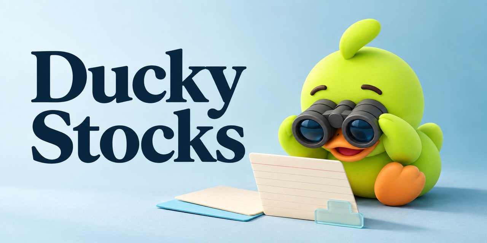
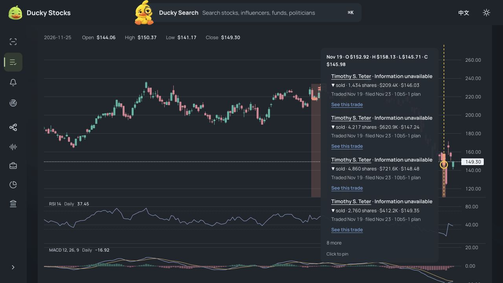
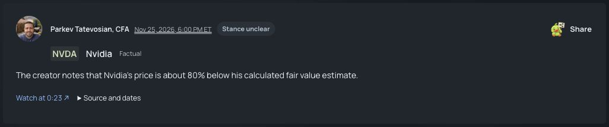
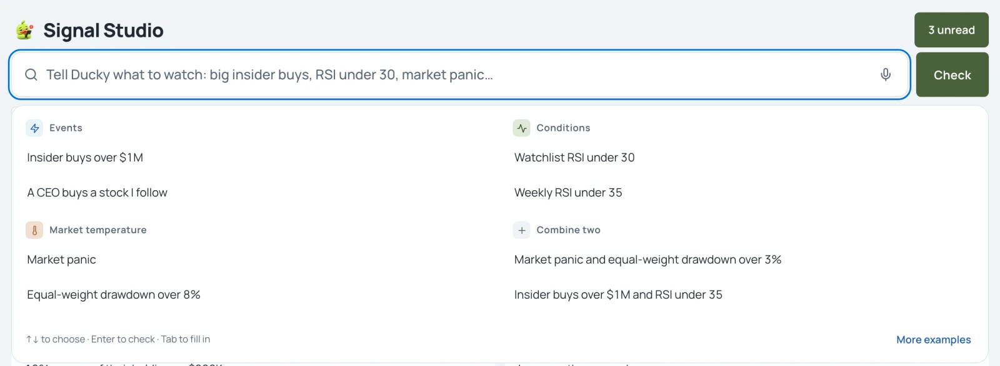

[](https://duckybot.app/en/)

**[Browse the Ducky 300 for free](https://duckybot.app/en/app/#/watchlist?scope=ducky&columns=all)**　·　[Signal Studio](https://duckybot.app/en/signal-studio-guide/)　·　[简体中文](README.zh-CN.md)

# Follow a stock back to the source

Who sold shares? What did a fund own last quarter? What did a YouTuber actually say? Ducky brings the filing, the chart and the original video together on one stock page.

Browse the Ducky 300 and preview up to ten different detail pages per browser without an account. A free account adds a personal watchlist, creator follows and Signal Studio. No card or subscription required.

## A closer look at NVIDIA

For a guest preview, open the Ducky 300 and select **NVDA**. The following links also work from your Ducky account. [Open the public stock table](https://duckybot.app/en/app/#/watchlist?scope=ducky&columns=all)

**Start with the trade.** NVIDIA executive Timothy S. Teter sold shares on November 19, 2026. He filed the Form 4 on November 23. Select the marker on the chart to see both dates. [Open NVIDIA](https://duckybot.app/en/app/#/stock/NVDA?tab=trail) · [Read the SEC filing](https://www.sec.gov/Archives/edgar/data/1045810/000169684126000016/0001696841-26-000016-index.htm)

[](https://duckybot.app/en/app/#/stock/NVDA?tab=trail)

**Hear the original argument.** On November 25, Parkev Tatevosian discussed his estimate of NVIDIA’s fair value. The link on his card starts the video at 0:23, so you can hear how he described it. [NVIDIA creator views](https://duckybot.app/en/app/#/stock/NVDA?tab=creators) · [Play from 0:23](https://www.youtube.com/watch?v=hOUk-GEHdM8&t=23s)

[](https://www.youtube.com/watch?v=hOUk-GEHdM8&t=23s)

**Check what a fund held.** Atreides Management filed its September 30 holdings on November 16, 2026. Compare its NVIDIA position with the previous quarter, then open its 13F. [Fund holdings](https://duckybot.app/en/app/#/stock/NVDA?tab=funds) · [Original 13F](https://www.sec.gov/Archives/edgar/data/1777813/000177781326000013/0001777813-26-000013-index.html)

## Try a rule in Signal Studio

Try **“Alert me when a stock on my watchlist has a daily RSI below 30.”** See which stocks matched in the past and how they moved against SPY. Turn on alerts to follow future matches. Signal Studio comes with every free account. [Open Signal Studio](https://duckybot.app/en/app/#/alerts) · [Read the guide](https://duckybot.app/en/signal-studio-guide/)

[](https://duckybot.app/en/signal-studio-guide/)

*The rule picker shows example conditions. Signal Studio simulates historical results.*

## Run the filing example

Python 3 and an internet connection are all you need. The example prints up to three SEC filing links and the cutoff date for Ducky’s public archive. This archive has a five-day delay.

```sh
git clone https://github.com/duckybotapp/ducky-stocks.git
cd ducky-stocks
python3 examples/filings.py NVDA --kind insider
python3 examples/filings.py NVDA --kind 13f
```

Replace `NVDA` with another ticker. The script uses the Python standard library and needs no API key. The MIT License covers the example code. Ducky hosts the research service. The original records follow their publishers’ terms. [Example code](examples/filings.py) · [License](LICENSE) · [Ducky terms](https://duckybot.app/en/terms/)

<details>
<summary><strong>How does Ducky compare with OpenStock?</strong></summary>

OpenStock covers nine markets and lets you host its terminal yourself. Its NVIDIA page pairs the chart with quarterly and annual reports. On Ducky, select a trade to see its filing date. The same stock page links to fund holdings and the exact moment in a creator’s video. [Inside OpenStock](https://openstock-ods.vercel.app/#inside) · [NVIDIA on OpenStock](https://openstock-ods.vercel.app/s/NVDA) · [NVIDIA on Ducky](https://duckybot.app/en/app/#/stock/NVDA)

</details>

## Back Ducky

<a href="https://buymeacoffee.com/duckybot"></a>

If Ducky saved you an afternoon of digging through filings, you can buy the duck a coffee. Backers help keep the research free with a one-time or monthly contribution. Everyone with a free account can use Signal Studio. [Become a backer](https://buymeacoffee.com/duckybot)
