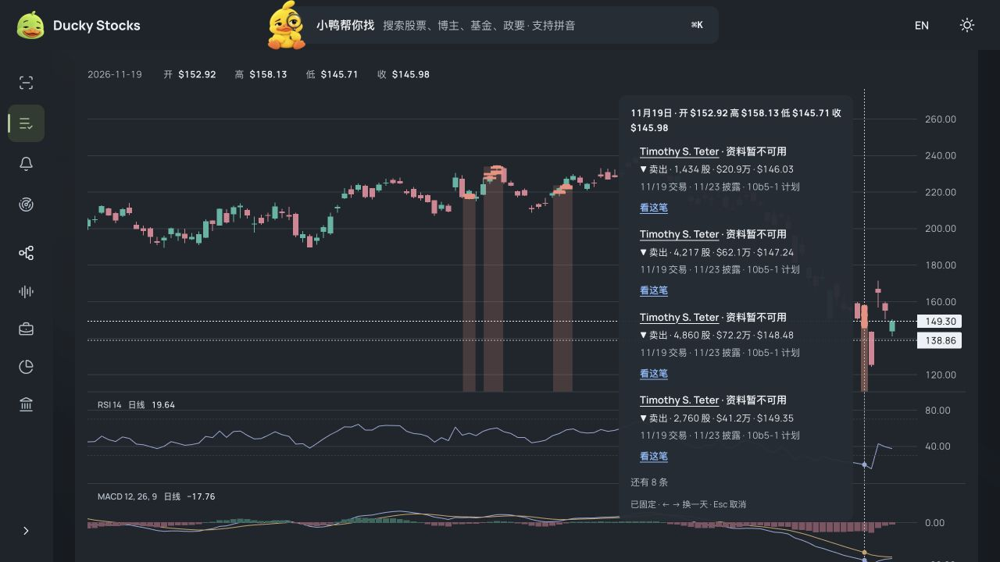
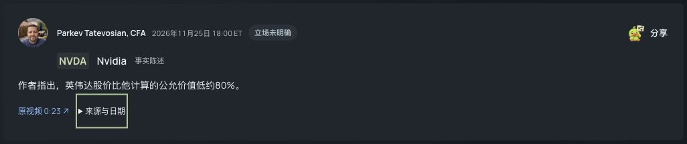
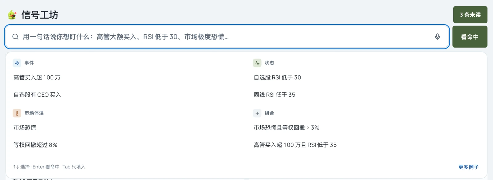

[](https://duckybot.app/zh/)

**[免费逛 Ducky 300 股票表](https://duckybot.app/zh/app/#/watchlist?scope=ducky&columns=all)**　·　[信号工坊](https://duckybot.app/zh/signal-studio-guide/)　·　[English](README.md)

# 从一只美股，查回一手资料

高管哪天卖了股票？基金上季度持有多少？财经博主在视频里到底怎么说？打开 Ducky 的一只股票，就能顺着股价图找到申报原件，也能跳到原视频里对应的那句话。

日常查这些资料，**不用花钱**。游客可以浏览 Ducky 300，每个浏览器可预览 10 个不同的详情页。免费注册后，还能保存自选股、关注博主、用信号工坊设提醒，无需绑卡或订阅。

## 拿英伟达查三件事

游客从 Ducky 300 股票表里点 **NVDA** 就能看英伟达。已登录的读者也可以直接点下面的个股链接。[打开公开股票表](https://duckybot.app/zh/app/#/watchlist?scope=ducky&columns=all)

**高管哪天卖的？** 英伟达高管 Timothy S. Teter 在 2026 年 11 月 19 日卖出股票，11 月 23 日才提交 Form 4。点开图上的标记，就能看到每笔交易，以及交易和披露各是哪天。[看英伟达的交易图](https://duckybot.app/zh/app/#/stock/NVDA?tab=trail) · [读 SEC 申报原件](https://www.sec.gov/Archives/edgar/data/1045810/000169684126000016/0001696841-26-000016-index.htm)

[](https://duckybot.app/zh/app/#/stock/NVDA?tab=trail)

**博主当时怎么说的？** 11 月 25 日，Parkev Tatevosian 谈到了他给英伟达算的公允价值。点头像旁这条记录里的「原视频」，就从第 23 秒开始听他本人怎么说。[英伟达的博主观点](https://duckybot.app/zh/app/#/stock/NVDA?tab=creators) · [从 0:23 播放](https://www.youtube.com/watch?v=hOUk-GEHdM8&t=23s)

[](https://www.youtube.com/watch?v=hOUk-GEHdM8&t=23s)

**基金上季度持有多少？** Atreides Management 在 2026 年 11 月 16 日提交的 13F，披露的是 9 月 30 日的持仓。打开「基金持仓」就能对照前后两个季度的英伟达股数，再回 SEC 核对。[看基金持仓](https://duckybot.app/zh/app/#/stock/NVDA?tab=funds) · [读 13F 原件](https://www.sec.gov/Archives/edgar/data/1777813/000177781326000013/0001777813-26-000013-index.html)

## 在信号工坊里试一条规则

试着输入 **「自选股日线 RSI 低于 30 时提醒我」**。先看过去哪些股票符合条件，以及之后和同期 SPY 相比表现如何。想跟踪下一次，就点「开始提醒」。信号工坊包含在免费账号里。[打开信号工坊](https://duckybot.app/zh/app/#/alerts) · [看使用指南](https://duckybot.app/zh/signal-studio-guide/)

[](https://duckybot.app/zh/signal-studio-guide/)

*图中是可以直接点选的规则示例。工坊展示的是历史模拟结果。*

## 用 Python 查公开申报

电脑有 Python 3、能上网，就能运行。示例每次最多列出三条 SEC 原始申报链接和本次查询的数据截止日期。公开档案延迟五天。

```sh
git clone https://github.com/duckybotapp/ducky-stocks.git
cd ducky-stocks
python3 examples/filings.py NVDA --kind insider
python3 examples/filings.py NVDA --kind 13f
```

把 `NVDA` 换成你关注的股票代码即可。示例只用 Python 标准库，无需账号或 API 密钥。示例代码采用 MIT 许可证，研究服务由 Ducky 托管，原始资料按各来源的条款使用。[示例代码](examples/filings.py) · [许可证](LICENSE) · [Ducky 使用条款](https://duckybot.app/zh/terms/)

<details>
<summary><strong>Ducky 和 OpenStock 有什么区别？</strong></summary>

OpenStock 能看九个市场，也可以装在自己的服务器上。它的英伟达页把图表和季报、年报放在一起。Ducky 更适合顺着一只股票追查具体的人和事，从图上的交易日查高管申报、核对基金持仓，或回到博主开口的那一秒。[OpenStock 功能](https://openstock-ods.vercel.app/#inside) · [OpenStock 英伟达页](https://openstock-ods.vercel.app/s/NVDA) · [Ducky 英伟达页](https://duckybot.app/zh/app/#/stock/NVDA)

</details>

## 请小鸭子喝杯咖啡

<a href="https://buymeacoffee.com/duckybot"></a>

如果小鸭子帮你省了翻申报、找视频的时间，可以请它喝杯咖啡。Backer 可以支持一次，也可以按月支持，让更多人免费用上这些工具。查资料、用信号工坊设提醒，免费账号就够了。[支持小鸭子](https://buymeacoffee.com/duckybot)
